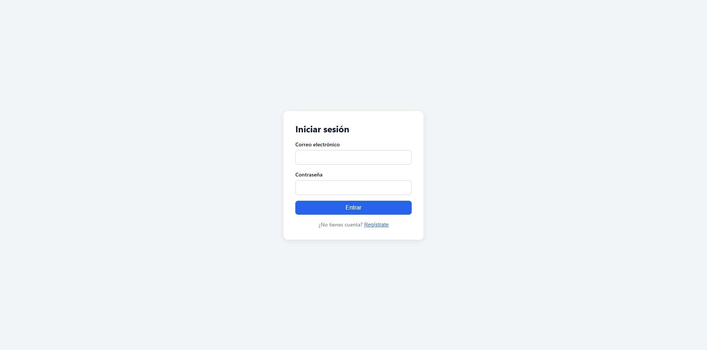
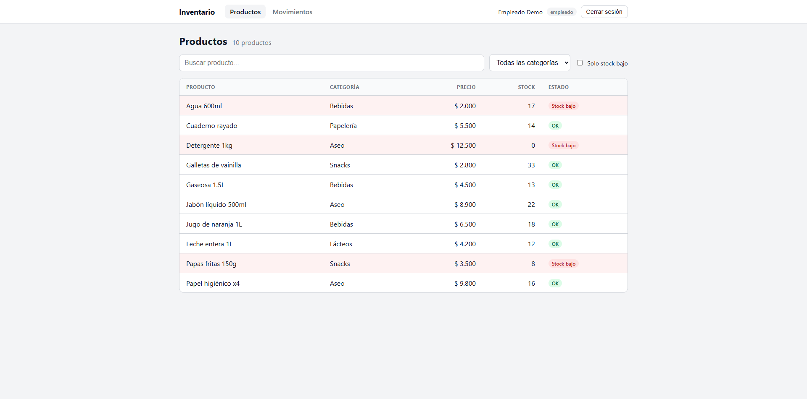
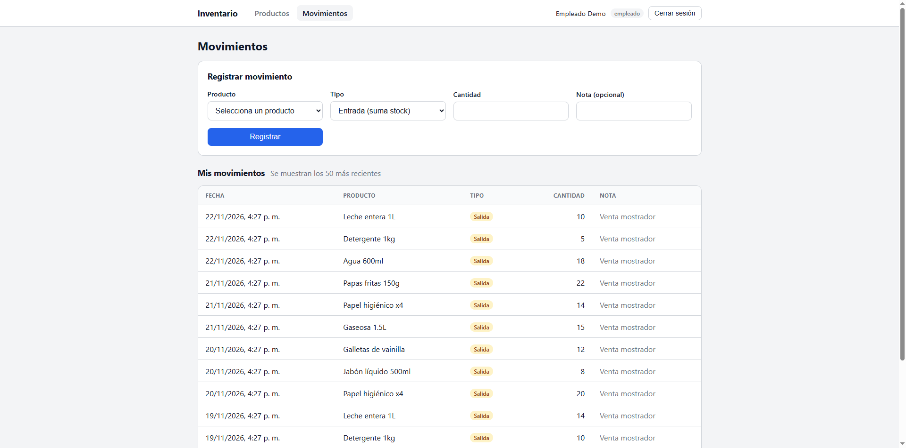
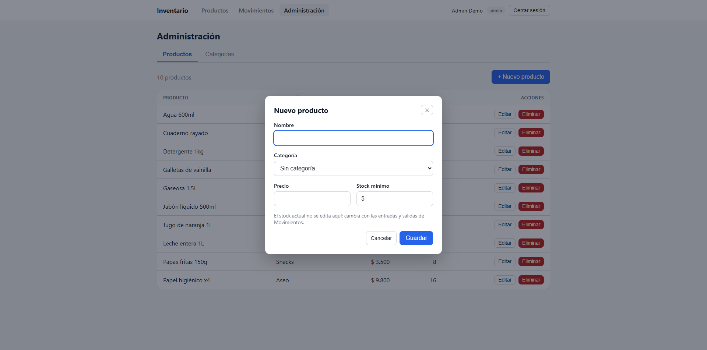
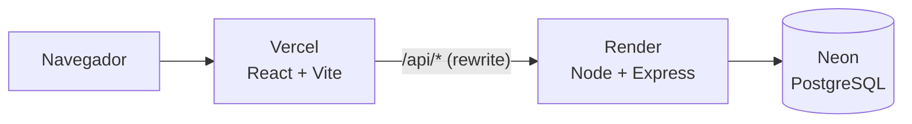

# Inventario App — Gestión de inventario

🌐 [English](README.md) · **Español**

Aplicación web fullstack para gestionar el inventario de un negocio pequeño: productos, categorías, movimientos de stock, alertas de poco stock y acceso por roles (admin / empleado).

**🔗 Demo en vivo:** https://inventario-app-steel.vercel.app

> El backend usa un plan gratuito y se duerme tras ~15 minutos sin tráfico, así que la primera petición puede tardar hasta un minuto. La base de datos también necesita unos segundos para despertar.

### Cuentas de demostración

| Rol | Correo | Contraseña |
|---|---|---|
| Admin | `admin@demo.test` | `Admin-Demo-2026` |
| Empleado | `empleado@demo.test` | `Empleado-Demo-2026` |

Es una demo pública y compartida: cualquiera puede modificar sus datos, por lo que pueden reiniciarse en cualquier momento. Por favor, no escribas datos personales reales.

## Capturas

| Inicio de sesión | Productos |
|---|---|
|  |  |

| Movimientos de stock | Panel de administración |
|---|---|
|  |  |

## Funcionalidades

- **Autenticación** con registro e inicio de sesión. Las cuentas nuevas se crean como `empleado`; el rol `admin` se asigna a mano en la base de datos.
- **Productos**: lista con búsqueda, filtro por categoría y filtro de «solo stock bajo». Las filas por debajo de su stock mínimo se resaltan.
- **Movimientos de stock**: entradas y salidas con una nota opcional. El stock se actualiza de forma atómica y una salida mayor al stock disponible se rechaza.
- **Historial**: el admin ve todos los movimientos; el empleado solo los suyos. Se muestran los 50 más recientes.
- **Panel de administración** (solo admin): crear, editar y eliminar productos y categorías con ventanas modales.
- **Integridad de datos**: un producto con movimientos no se puede eliminar, al borrar una categoría sus productos quedan sin categoría, y los nombres de categoría son únicos sin distinguir mayúsculas ni tildes.
- Diseño **responsive**, con modales nativos `<dialog>`.

## Tecnologías

| Capa | Tecnologías |
|---|---|
| Frontend | React, Vite, React Router, CSS puro (variables CSS) |
| Backend | Node.js, Express 5, `pg`, bcryptjs, jsonwebtoken, cookie-parser, cors, helmet, express-rate-limit, dotenv |
| Base de datos | PostgreSQL (Neon en producción) |
| Hosting | Vercel (frontend), Render (API), Neon (base de datos) |

## Arquitectura



El navegador solo habla con Vercel. Una regla de reescritura en `Frontend/vercel.json` reenvía cada petición `/api/*` al servidor Express de Render, así que el navegador ve **un solo origen**. Esto hace que la cookie de sesión sea de primera parte (los navegadores no la bloquean como cookie de terceros) y elimina las peticiones entre dominios. En desarrollo, el servidor de Vite reenvía `/api` a `localhost:3000`, por lo que el mismo código funciona en ambos entornos.

### Estructura del proyecto

```
Inventario-app/
├── Backend/
│   ├── database/
│   │   ├── schema.sql          # tablas, restricciones e índices
│   │   └── seed_demo.sql       # datos de demo (reinicia productos, categorías y movimientos)
│   ├── src/
│   │   ├── index.js            # configuración de la app y orden de middlewares
│   │   ├── db.js               # pool de conexiones a PostgreSQL
│   │   ├── middleware/         # auth (cookie JWT, roles) y límites de intentos
│   │   └── routes/             # auth, categorias, productos, movimientos
│   └── .env.example
├── Frontend/
│   ├── src/
│   │   ├── pages/              # Login, Productos, Movimientos, Administracion
│   │   ├── components/         # Layout, Modal, AdminProductos, AdminCategorias
│   │   ├── api.js              # envoltorio de fetch (credenciales, errores)
│   │   └── App.jsx             # verificación de sesión y rutas
│   ├── vercel.json             # proxy de /api y regreso a index.html
│   └── .env.example
└── docs/screenshots/
```

## Base de datos

Cuatro tablas: `usuarios`, `categorias`, `productos` y `movimientos`. Las reglas viven tanto en la base de datos como en la API:

- Restricciones `CHECK` para el rol, el tipo de movimiento, las cantidades positivas y el precio y stock no negativos.
- Llaves foráneas: `productos → categorias` (`ON DELETE SET NULL`) y `movimientos → productos / usuarios`.
- Un índice único sobre `normalizar_texto(nombre)` (minúsculas + `unaccent`), de modo que «Lácteos», «lacteos» y «LÁCTEOS» cuentan como la misma categoría.
- `NUMERIC(12, 2)` para los precios en lugar de números de coma flotante.

## API

Los nombres de las rutas están en español, igual que el modelo de dominio.

| Método | Ruta | Acceso | Descripción |
|---|---|---|---|
| POST | `/api/auth/register` | Público | Crear una cuenta (rol `empleado`) |
| POST | `/api/auth/login` | Público | Iniciar sesión y guardar la cookie |
| POST | `/api/auth/logout` | Público | Borrar la cookie de sesión |
| GET | `/api/auth/perfil` | Con sesión | Usuario actual |
| GET | `/api/categorias` | Con sesión | Listar categorías |
| POST, PUT, DELETE | `/api/categorias[/:id]` | Admin | Crear, renombrar, eliminar |
| GET | `/api/productos` | Con sesión | Listar. Filtros: `buscar`, `categoria_id`, `stock_bajo=true` |
| GET | `/api/productos/:id` | Con sesión | Detalle de un producto |
| POST, PUT, DELETE | `/api/productos[/:id]` | Admin | Crear, editar, eliminar |
| GET | `/api/movimientos` | Con sesión | Historial (admin: todos, empleado: los suyos). Filtros: `producto_id`, `tipo`, `limite` |
| POST | `/api/movimientos` | Con sesión | Registrar una entrada o salida |
| GET | `/api/health` | Público | Verificación de la API y la base de datos |

## Seguridad y decisiones técnicas

- **Sesión en una cookie `HttpOnly`, no en `localStorage`.** JavaScript no puede leer el token, así que una falla XSS no puede robarlo. La cookie es `Secure` en producción y `SameSite=Lax`, lo que además protege las rutas que modifican datos (`POST`, `PUT`, `DELETE`) contra CSRF.
- **Las contraseñas** se guardan con hash bcrypt (costo 10) y nunca se almacenan ni se devuelven en texto plano. Los fallos de login usan un mismo mensaje genérico, para que la API no revele qué correos existen.
- **La autorización se aplica en el servidor.** `verificarToken` y `soloAdmin` protegen las rutas; ocultar opciones del menú en el frontend es solo una comodidad. El usuario de un movimiento siempre sale del token, nunca del cuerpo de la petición.
- **SQL parametrizado en todas partes** (`$1, $2...`) para prevenir inyección SQL, además de validar cada dato en el servidor.
- **Transacciones con bloqueo de filas.** Un movimiento se ejecuta dentro de `BEGIN ... COMMIT` y lee el producto con `SELECT ... FOR UPDATE`, así dos salidas simultáneas no pueden pasar ambas la validación de stock, y el stock y el movimiento se guardan juntos o no se guardan.
- **El stock nunca se edita directamente:** solo cambia mediante movimientos, por lo que siempre coincide con el historial.
- **Límite de intentos** (producción): 10 inicios de sesión fallidos cada 15 minutos y 5 registros por hora por IP. Los inicios exitosos no cuentan.
- **Cabeceras de seguridad con `helmet`** y **CORS** restringido al origen del frontend.
- **`trust proxy` medido, no adivinado.** Detrás de Vercel y Render, Express necesita saber cuántos proxies son de confianza para leer la IP real del visitante; si no, todos los usuarios compartirían una IP y el limitador bloquearía a todos a la vez. El valor se midió con una ruta de diagnóstico temporal y se configura con `TRUST_PROXY`.
- **SQL directo con `pg` en lugar de un ORM**, para tener control total de las consultas y del esquema.

## Ejecutarlo en local

**Requisitos:** Node.js 20.19+ o 22.12+ (requisito de Vite) y PostgreSQL (probado en la 18) con la extensión `unaccent`, que viene con la distribución estándar.

**1. Clona el repositorio**

```bash
git clone https://github.com/alopez18dev/Inventario-app.git
cd Inventario-app
```

**2. Crea la base de datos**

Crea una base de datos vacía llamada `inventario_db` y ejecuta en ella `Backend/database/schema.sql`, con el Query Tool de pgAdmin o con:

```bash
psql -U postgres -d inventario_db -f Backend/database/schema.sql
```

**3. Inicia el backend**

```bash
cd Backend
cp .env.example .env     # en PowerShell: Copy-Item .env.example .env
```

Edita `.env` (contraseña de la base de datos y un `JWT_SECRET`). Puedes generar el secreto con:

```bash
node --input-type=module -e "import { randomBytes } from 'node:crypto'; console.log(randomBytes(48).toString('hex'))"
```

```bash
npm install
npm run dev              # http://localhost:3000/api/health
```

**4. Inicia el frontend** (en otra terminal)

```bash
cd Frontend
cp .env.example .env
npm install
npm run dev              # http://localhost:5173
```

**5. Crea un admin**

Regístrate desde la app, convierte la cuenta en admin en la base de datos y vuelve a iniciar sesión:

```sql
UPDATE usuarios SET rol = 'admin' WHERE email = 'tu-correo@ejemplo.com';
```

*(Opcional)* `Backend/database/seed_demo.sql` carga productos y movimientos de ejemplo. Requiere que existan antes las cuentas `admin@demo.test` y `empleado@demo.test`.

### Variables de entorno

| Variable | Dónde | Descripción |
|---|---|---|
| `PORT` | Backend | Puerto de la API (por defecto `3000`) |
| `NODE_ENV` | Backend | `production` activa las cookies `Secure` y los límites de intentos más estrictos |
| `DATABASE_URL` | Backend | Cadena de conexión completa (producción). Reemplaza a `DB_*` y activa SSL |
| `DB_HOST`, `DB_PORT`, `DB_NAME`, `DB_USER`, `DB_PASSWORD` | Backend | Conexión a la base de datos local |
| `JWT_SECRET` | Backend | Secreto con el que se firman los tokens |
| `FRONTEND_URL` | Backend | Origen permitido por CORS, sin barra final |
| `TRUST_PROXY` | Backend | Número de proxies de confianza delante de Express (`0` en local) |
| `VITE_API_URL` | Frontend | Ruta base de la API (`/api`) |

## Despliegue

1. **Neon:** crea un proyecto y ejecuta `schema.sql` en el editor SQL.
2. **Render:** crea un Web Service desde este repositorio con *Root Directory* `Backend`, comando de build `npm install` y comando de inicio `npm start`. Agrega las variables del backend, usando `DATABASE_URL` para la conexión a Neon.
3. **Vercel:** importa el repositorio con *Root Directory* `Frontend` y la variable `VITE_API_URL=/api`. `Frontend/vercel.json` reenvía `/api/*` al servicio de Render y devuelve `index.html` para que las rutas del lado del cliente sobrevivan a una recarga.

## Limitaciones conocidas y próximos pasos

- Al cerrar sesión se borra la cookie, pero el JWT no se revoca en el servidor: un token robado seguiría siendo válido hasta que expire (8 horas). Un próximo paso son tokens de acceso de vida corta más refresh tokens rotativos guardados en la base de datos.
- El limitador guarda sus contadores en memoria, así que se reinicia con el servidor. Llamar directamente a la URL de Render, saltándose Vercel, permitiría falsear la IP con la cabecera `X-Forwarded-For` y evadir el límite.
- Todavía no hay pruebas automatizadas. Lo primero serían pruebas de integración de la transacción de movimientos y de los permisos por rol.
- No hay pantalla para gestionar usuarios (los admin se asignan en la base de datos), ni recuperación de contraseña ni verificación de correo.
- Las listas no tienen paginación, y el historial de movimientos se limita a los 50 más recientes.
- La moneda de los precios (COP) está fija en `Frontend/src/formato.js`.
- En los planes gratuitos, el backend y la base de datos tienen arranques en frío tras la inactividad.

## Autor

**Alejandro López** — [@alopez18dev](https://github.com/alopez18dev)