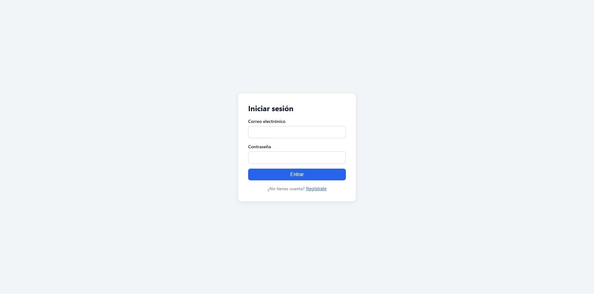
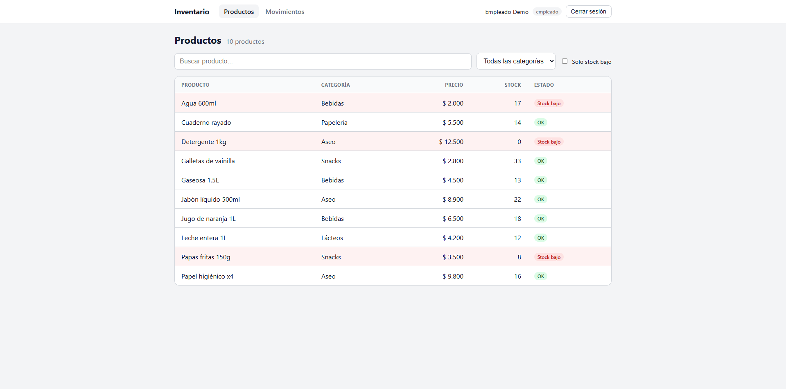
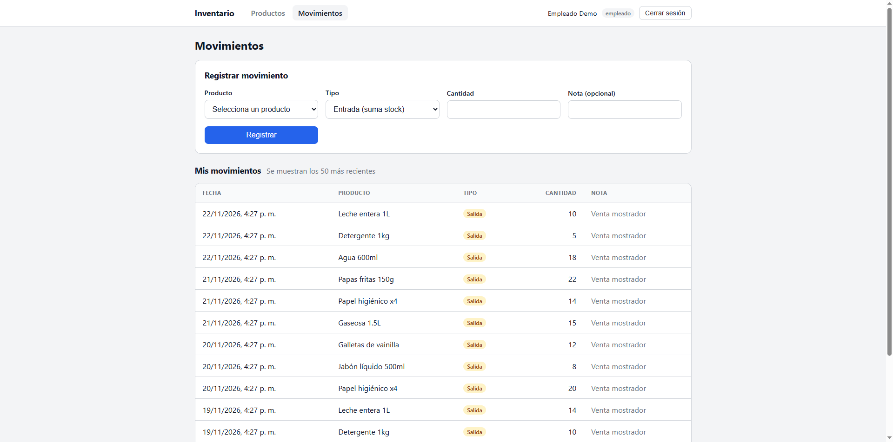
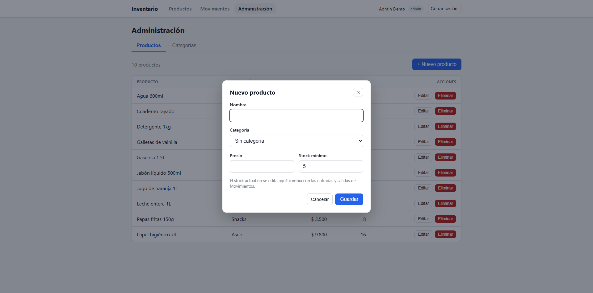
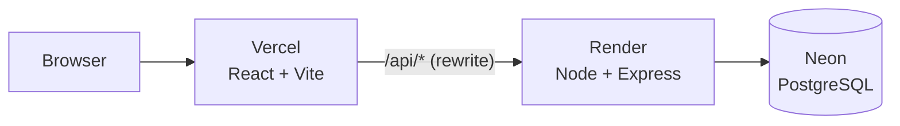

# Inventario App — Inventory Management

🌐 **English** · [Español](README.es.md)

Full-stack web application to manage the inventory of a small business: products, categories, stock movements, low-stock alerts and role-based access (admin / employee).

**🔗 Live demo:** https://inventario-app-steel.vercel.app

> The backend runs on a free plan and sleeps after ~15 minutes without traffic, so the first request can take up to a minute. The database also needs a few seconds to wake up.

### Demo accounts

| Role | Email | Password |
|---|---|---|
| Admin | `admin@demo.test` | `Admin-Demo-2026` |
| Employee | `empleado@demo.test` | `Empleado-Demo-2026` |

This is a shared public demo: anyone can change its data, so it may be reset at any time. Please do not enter real personal data.

## Screenshots

| Login | Products |
|---|---|
|  |  |

| Stock movements | Admin panel |
|---|---|
|  |  |

## Features

- **Authentication** with registration and login. New accounts are created as `empleado`; the `admin` role is assigned manually in the database.
- **Products**: list with search, category filter and a "low stock only" filter. Rows below their minimum stock are highlighted.
- **Stock movements**: entries and exits with an optional note. The stock is updated atomically and an exit larger than the available stock is rejected.
- **History**: the admin sees every movement; an employee only sees their own. The 50 most recent are shown.
- **Admin panel** (admin only): create, edit and delete products and categories using modals.
- **Data integrity**: a product with movements cannot be deleted, deleting a category leaves its products uncategorized, and category names are unique ignoring case and accents.
- **Responsive** layout, with native `<dialog>` modals.

## Tech stack

| Layer | Technologies |
|---|---|
| Frontend | React, Vite, React Router, plain CSS (custom properties) |
| Backend | Node.js, Express 5, `pg`, bcryptjs, jsonwebtoken, cookie-parser, cors, helmet, express-rate-limit, dotenv |
| Database | PostgreSQL (Neon in production) |
| Hosting | Vercel (frontend), Render (API), Neon (database) |

## Architecture



The browser only talks to Vercel. A rewrite rule in `Frontend/vercel.json` forwards every `/api/*` request to the Express server on Render, so the browser sees a **single origin**. That makes the session cookie first-party (not blocked as a third-party cookie) and removes the need for cross-origin requests. In development, the Vite dev server proxies `/api` to `localhost:3000`, so the same code works in both environments.

### Project structure

```
Inventario-app/
├── Backend/
│   ├── database/
│   │   ├── schema.sql          # tables, constraints and indexes
│   │   └── seed_demo.sql       # demo data (resets products, categories and movements)
│   ├── src/
│   │   ├── index.js            # app setup and middleware order
│   │   ├── db.js               # PostgreSQL connection pool
│   │   ├── middleware/         # auth (JWT cookie, roles) and rate limits
│   │   └── routes/             # auth, categorias, productos, movimientos
│   └── .env.example
├── Frontend/
│   ├── src/
│   │   ├── pages/              # Login, Productos, Movimientos, Administracion
│   │   ├── components/         # Layout, Modal, AdminProductos, AdminCategorias
│   │   ├── api.js              # fetch wrapper (credentials, errors)
│   │   └── App.jsx             # session check and routes
│   ├── vercel.json             # /api proxy and SPA fallback
│   └── .env.example
└── docs/screenshots/
```

## Database

Four tables: `usuarios`, `categorias`, `productos` and `movimientos`. The rules live in the database as well as in the API:

- `CHECK` constraints for the role, the movement type, positive quantities, and non-negative price and stock.
- Foreign keys: `productos → categorias` (`ON DELETE SET NULL`) and `movimientos → productos / usuarios`.
- A unique index on `normalizar_texto(nombre)` (lowercase + `unaccent`), so "Lácteos", "lacteos" and "LÁCTEOS" count as the same category.
- `NUMERIC(12, 2)` for prices instead of floating point.

## API

Route names are in Spanish, like the domain model.

| Method | Route | Access | Description |
|---|---|---|---|
| POST | `/api/auth/register` | Public | Create an account (role `empleado`) |
| POST | `/api/auth/login` | Public | Log in and set the session cookie |
| POST | `/api/auth/logout` | Public | Clear the session cookie |
| GET | `/api/auth/perfil` | Logged in | Current user |
| GET | `/api/categorias` | Logged in | List categories |
| POST, PUT, DELETE | `/api/categorias[/:id]` | Admin | Create, rename, delete |
| GET | `/api/productos` | Logged in | List. Filters: `buscar`, `categoria_id`, `stock_bajo=true` |
| GET | `/api/productos/:id` | Logged in | Product detail |
| POST, PUT, DELETE | `/api/productos[/:id]` | Admin | Create, edit, delete |
| GET | `/api/movimientos` | Logged in | History (admin: all, employee: own). Filters: `producto_id`, `tipo`, `limite` |
| POST | `/api/movimientos` | Logged in | Register an entry or exit |
| GET | `/api/health` | Public | API and database check |

## Security and technical decisions

- **Session in an `HttpOnly` cookie, not `localStorage`.** JavaScript cannot read the token, so an XSS flaw cannot steal it. The cookie is `Secure` in production and `SameSite=Lax`, which also protects the state-changing routes (`POST`, `PUT`, `DELETE`) against CSRF.
- **Passwords** are hashed with bcrypt (cost 10) and never stored or returned in plain text. Login failures use one generic message, so the API does not reveal which emails exist.
- **Authorization is enforced on the server.** `verificarToken` and `soloAdmin` protect the routes; hiding menu items in the frontend is only a convenience. The user of a movement always comes from the token, never from the request body.
- **Parameterized SQL everywhere** (`$1, $2...`) to prevent SQL injection, plus server-side validation of every input.
- **Transactions with row locks.** A movement runs inside `BEGIN ... COMMIT` and reads the product with `SELECT ... FOR UPDATE`, so two simultaneous exits cannot both pass the stock check, and the stock and the movement are saved together or not at all.
- **Stock is never edited directly:** it only changes through movements, so it always matches the history.
- **Rate limiting** (production): 10 failed logins per 15 minutes and 5 registrations per hour for each IP. Successful logins do not count.
- **`helmet`** security headers and **CORS** restricted to the frontend origin.
- **`trust proxy` measured, not guessed.** Behind Vercel and Render, Express needs to know how many proxies are trusted to read the real visitor IP, otherwise every user would share one IP and the rate limiter would block everybody together. The value was measured with a temporary diagnostic route and is configured through `TRUST_PROXY`.
- **Plain SQL with `pg` instead of an ORM**, to keep full control of the queries and the schema.

## Run it locally

**Requirements:** Node.js 20.19+ or 22.12+ (a Vite requirement), and PostgreSQL (tested on 18) with the `unaccent` extension, which ships with the standard distribution.

**1. Clone the repository**

```bash
git clone https://github.com/alopez18dev/Inventario-app.git
cd Inventario-app
```

**2. Create the database**

Create an empty database called `inventario_db` and run `Backend/database/schema.sql` on it, with pgAdmin's Query Tool or with:

```bash
psql -U postgres -d inventario_db -f Backend/database/schema.sql
```

**3. Start the backend**

```bash
cd Backend
cp .env.example .env     # on PowerShell: Copy-Item .env.example .env
```

Edit `.env` (database password and a `JWT_SECRET`). You can generate the secret with:

```bash
node --input-type=module -e "import { randomBytes } from 'node:crypto'; console.log(randomBytes(48).toString('hex'))"
```

```bash
npm install
npm run dev              # http://localhost:3000/api/health
```

**4. Start the frontend** (in another terminal)

```bash
cd Frontend
cp .env.example .env
npm install
npm run dev              # http://localhost:5173
```

**5. Create an admin**

Register from the app, then promote the account in the database and log in again:

```sql
UPDATE usuarios SET rol = 'admin' WHERE email = 'your-email@example.com';
```

*(Optional)* `Backend/database/seed_demo.sql` loads sample products and movements. It expects the accounts `admin@demo.test` and `empleado@demo.test` to exist first.

### Environment variables

| Variable | Where | Description |
|---|---|---|
| `PORT` | Backend | API port (default `3000`) |
| `NODE_ENV` | Backend | `production` enables `Secure` cookies and the stricter rate limits |
| `DATABASE_URL` | Backend | Full connection string (production). Overrides `DB_*` and enables SSL |
| `DB_HOST`, `DB_PORT`, `DB_NAME`, `DB_USER`, `DB_PASSWORD` | Backend | Local database connection |
| `JWT_SECRET` | Backend | Secret used to sign tokens |
| `FRONTEND_URL` | Backend | Origin allowed by CORS, without trailing slash |
| `TRUST_PROXY` | Backend | Number of trusted proxy hops in front of Express (`0` locally) |
| `VITE_API_URL` | Frontend | API base path (`/api`) |

## Deployment

1. **Neon:** create a project and run `schema.sql` in the SQL editor.
2. **Render:** create a Web Service from this repository with *Root Directory* `Backend`, build command `npm install` and start command `npm start`. Add the backend variables, using `DATABASE_URL` for the Neon connection.
3. **Vercel:** import the repository with *Root Directory* `Frontend` and the variable `VITE_API_URL=/api`. `Frontend/vercel.json` proxies `/api/*` to the Render service and falls back to `index.html` so client-side routes survive a page reload.

## Known limitations and next steps

- Logout clears the cookie, but the JWT is not revoked on the server: a stolen token stays valid until it expires (8 hours). A next step is short-lived access tokens plus rotating refresh tokens stored in the database.
- The rate limiter keeps its counters in memory, so it resets when the server restarts. Calling the Render URL directly, skipping Vercel, would let a client spoof its IP with the `X-Forwarded-For` header and evade the limit.
- There are no automated tests yet. Integration tests for the movement transaction and the role checks would come first.
- There is no screen to manage users (admins are assigned in the database), no password reset and no email verification.
- Lists are not paginated, and the movement history is capped at the 50 most recent.
- The price currency (COP) is fixed in `Frontend/src/formato.js`.
- On free plans, the backend and the database have cold starts after inactivity.

## Author

**Alejandro López** — [@alopez18dev](https://github.com/alopez18dev)